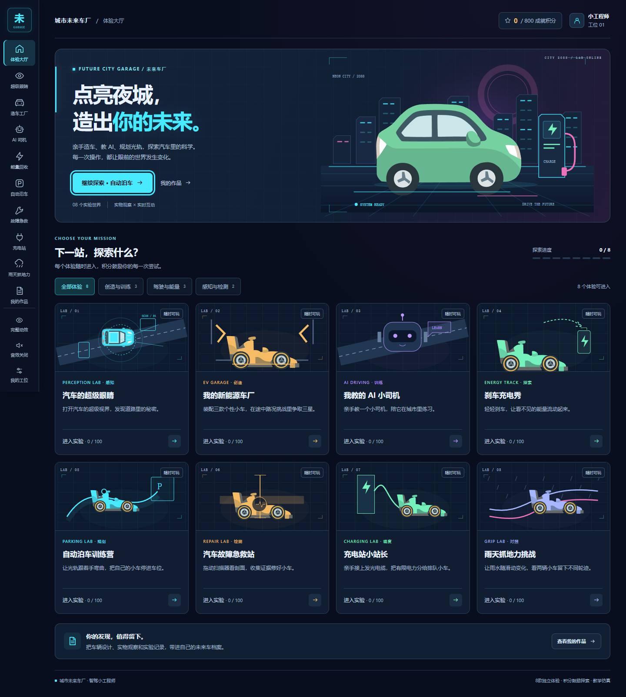
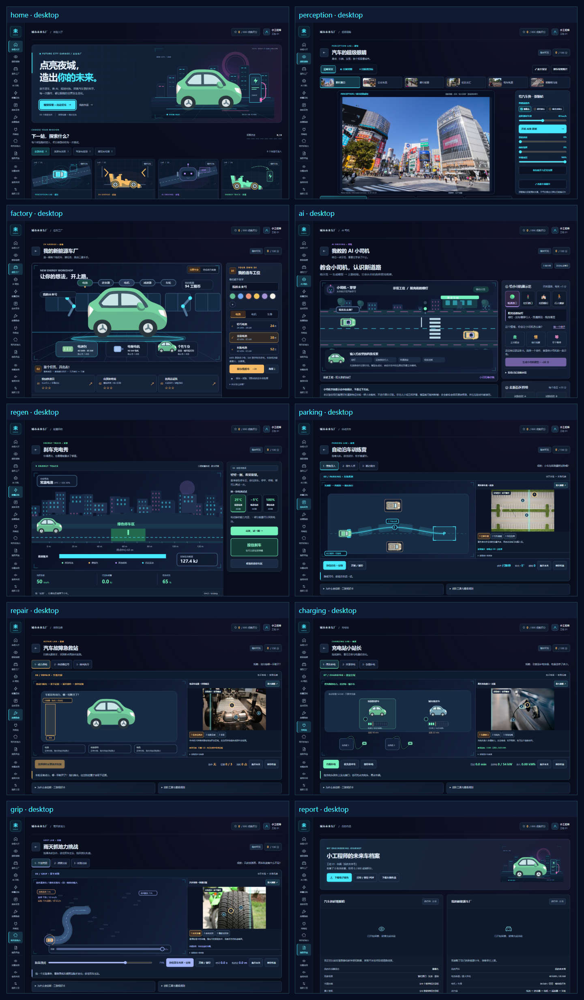
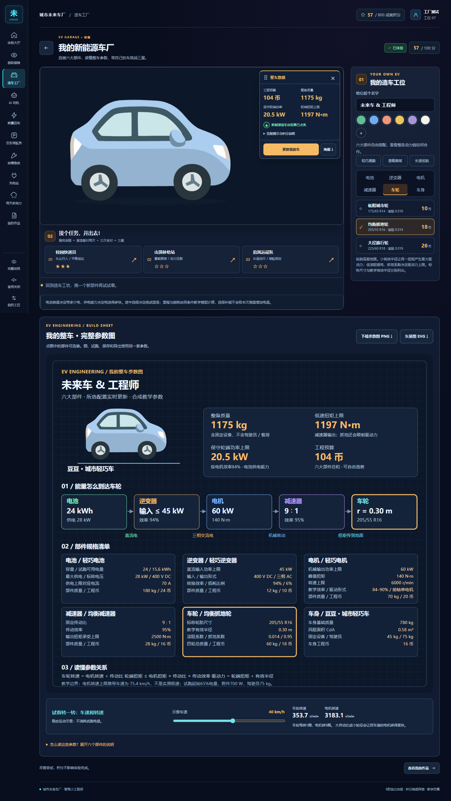
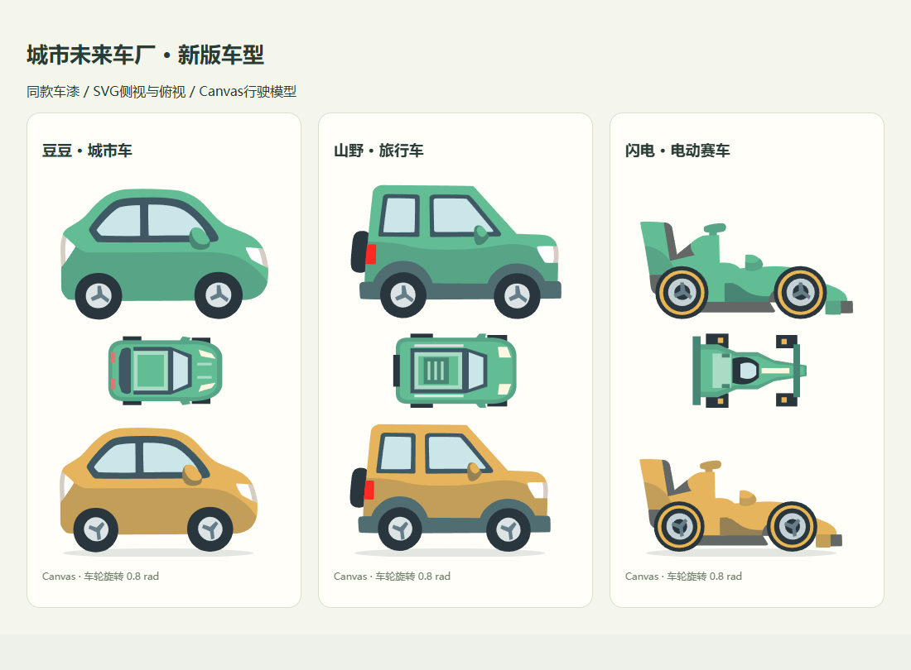
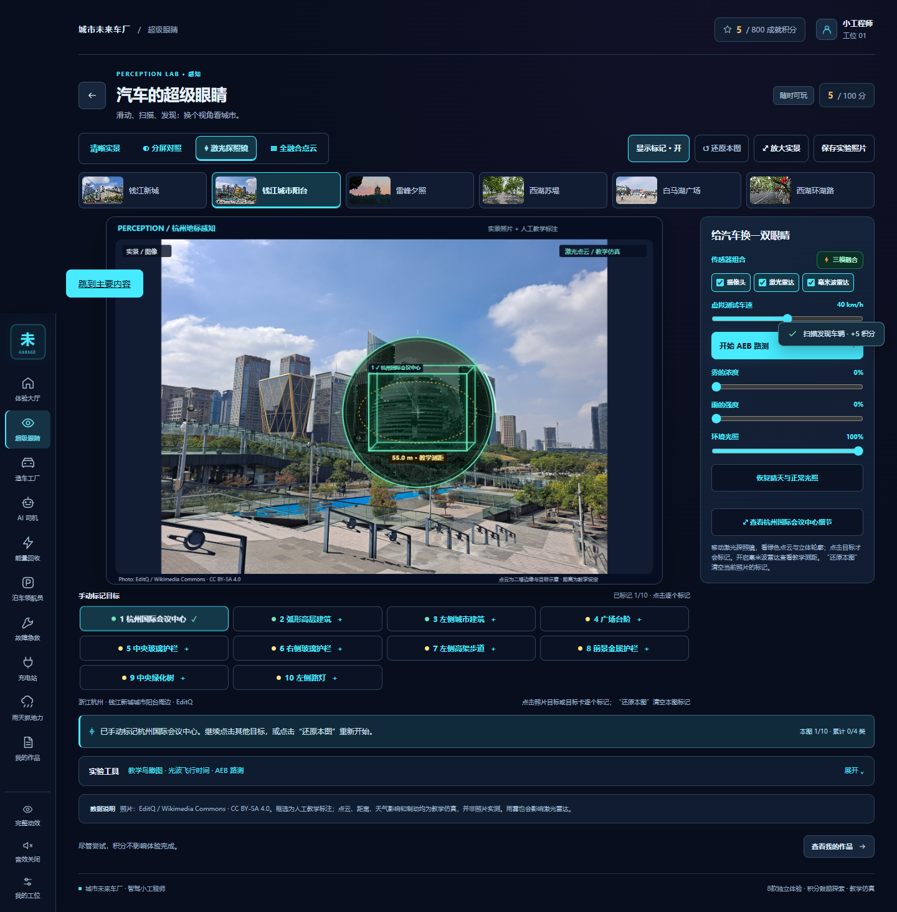
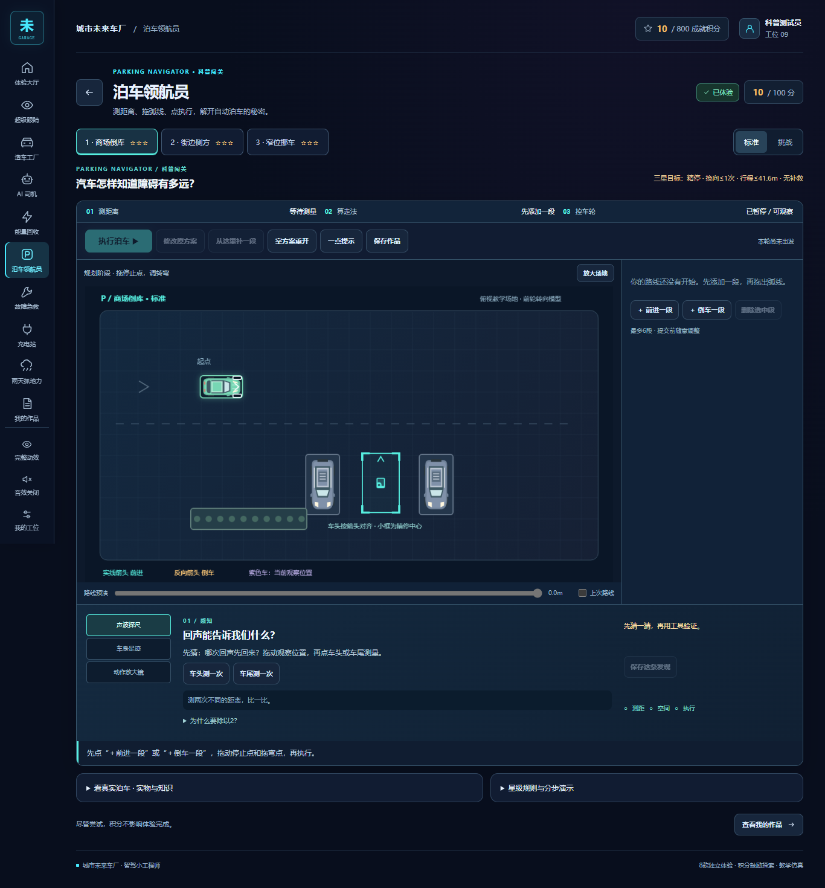
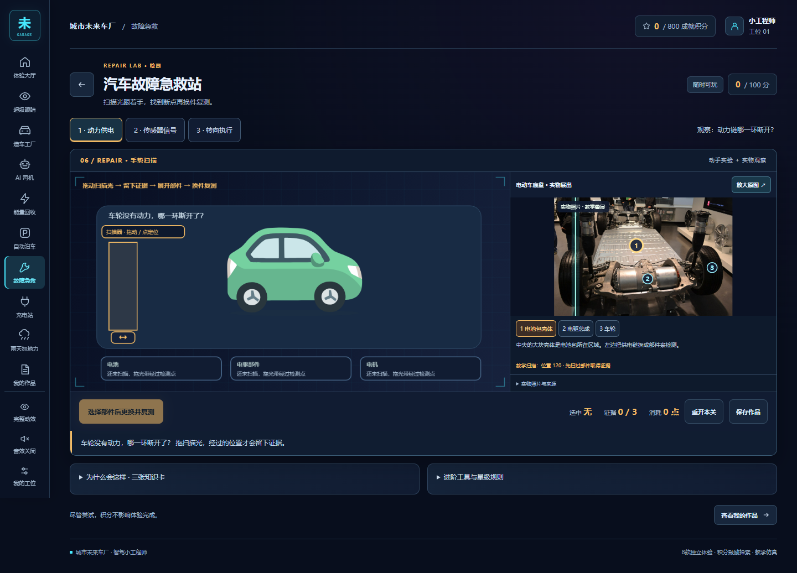
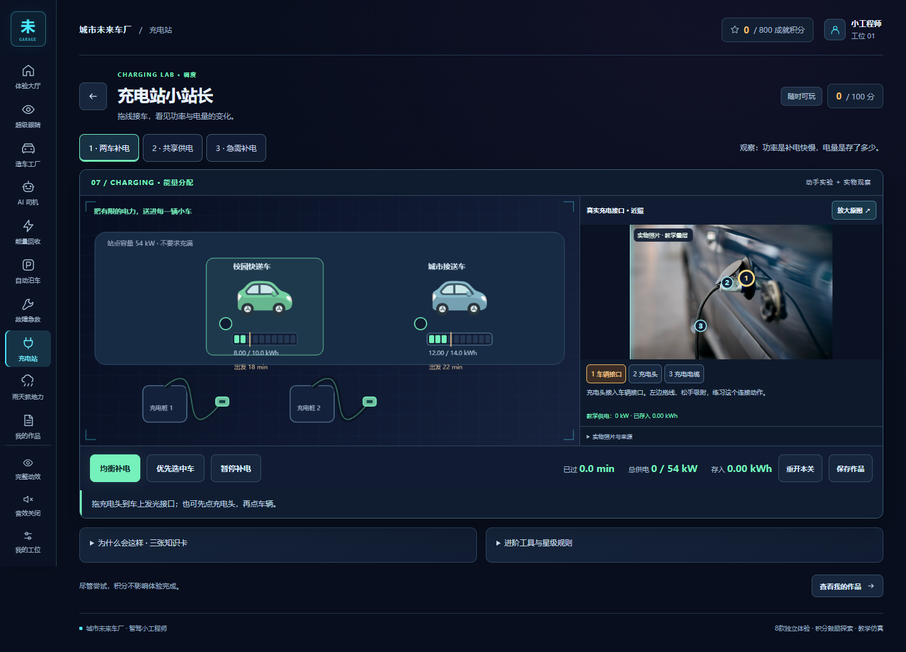
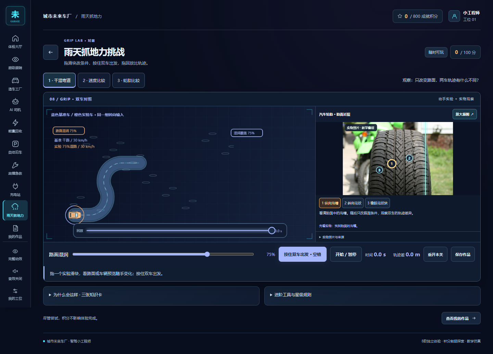

# 城市未来车厂 · 智驾小工程师

八款独立的二维 HTML 科普体验：汽车的超级眼睛、我的新能源车厂、我教的 AI 小司机、回能快递员、自动泊车训练营、汽车故障急救站、充电站小站长、雨天抓地力挑战。大厅、八游戏与作品页已统一为赛博朋克夜城风格。新增四款以“操作触发特效，特效实时跟手”为重点，并加入六张实物照片作为观察依据。



视觉、UI与验证方案见 [八游戏赛博朋克改造](docs/cyberpunk-redesign.md)。

## 直接运行

2026-11-18 优化版已修复窄屏天气工具条、手机开始/结算卡片裁切及矮窗口操作区适配。离线页面体积减少约 24%，原照片和标注尺寸保留；桌面包精简多余语言资源。当前八游戏的完整操作回归与交付说明见 [优化与单文件交付](docs/optimization-2026-11-18.md)。`npm run build` 同时更新根目录的离线 HTML；`npm run test:ui` 检查全部十页面与八游戏。

Windows 单文件免安装版：双击 `release/windows/城市未来车厂-双击运行.exe` 直接进入游戏。已内置 Electron / Chromium 与全部游戏资源，不需要安装或联网；可以将一个 EXE 复制到桌面或 U 盘使用。支持 Windows 10/11 x64，运行 `npm run package:win:portable` 可重新打包。

Windows 安装版：双击 `release/windows/CityFutureGarage-Setup-1.0.0-x64.exe`，使用中文向导安装。八款游戏、全部素材及 Chromium 运行环境都包含在安装包内，安装与使用无需联网，支持 Windows 10/11 x64。安装、存档和重新打包说明见 [Windows 完整离线版](docs/windows-offline.md)。开发者运行 `npm run package:win` 可重新生成安装程序。

双击根目录的 `城市未来车厂-双击打开.html` 即可离线体验；图片、脚本和样式均内嵌，建议使用 Chrome 或 Edge。源码在 GitHub 下载后，可直接在仓库页面打开该 HTML 文件，或克隆到本机运行。

电脑使用左侧滚动导航，手机使用顶部横向导航。大厅可按创造、驾驶与能量、感知与检测筛选，也可继续最近的体验；每款三关均开放。每款 100 分，共 800 分、8 枚体验章；参与与探索只加分；完成主体验即可盖章，低分也可继续和下载报告。

点击“我的工位”修改昵称与工位号。记录自动保存在当前浏览器的本机存储中，旧四款存档自动补齐新增条目，保留原昵称、车辆、积分与截图。每位学生应在自己的电脑浏览器操作；本版本不含跨电脑实时排名或教师汇总端。

“我的作品”可下载独立 HTML 报告、PNG 车辆海报，或通过浏览器打印为 PDF。报告含实际体验记录；未体验项目不会伪装成完成。换浏览器、清理存储或换文件路径可能使用新的存档位置，结课请下载作品。

## 操作

- **感知：**提供浙江杭州的下沙路口、湖州街公交、望江路骑行、南山路林荫、街边停车、莫干山路口六张实景照片。点击缩略图切换场景，标框与扫描记录同步切换；“放大实景”查看照片和目标细节。切换分屏或扫描，试试天气、光照与传感器；展开实验工具查看鸟瞰图、ToF 和辅助制动路测，再保存作品。
- **造车：**电池、逆变器、电机、减速器、车轮与车身各有三种配置，可点击选装；通勤、爬坡、长途有一键参考方案。配置改变会更新质量、供电、扭矩、滚阻与试跑结果。下方完整参数图显示六部件规格、能量链和计算关系，点击图中部件可选装，支持PNG、SVG下载；拖车速滑块观察车轮与电机转速。主图以纯色背景只展示车辆，选装与参数说明置于主图之外。颜色、车型和昵称继续同步用于其他游戏、海报及报告。旧积分、星级和试跑记录保留。说明见 [造车工厂选装与参数](docs/factory-configuration.md)。
- **任务闯关：**选择校园快递员、山顶补给站或追风远征队。途中有三次路况选择，答错会给出解释，可重新选择；每次选对后点击“继续出发”。跑完全程得一星，至少两题首选正确再得一星，三题全都首选正确获得第三星。18种事件随重玩轮换，答案位置也会变化；结算可以复盘、再挑战或进入下一关，最佳星级自动保存在本机。所有任务都可直接进入。挑战选择决定星级，里程和用电仍由同条件教学模型计算。
- **AI：**在三车道夜城中实时训练，覆盖绿灯畅通、路口红灯、行人横穿、施工占道、校园限速和急救车接近六类路况。遇到未掌握的路况会进入慢动作，留出5.5秒判断窗口；点“前行、慢行、刹停、变道”或按1/2/3/4示范，概率权重教学模型立即学习。暂停会保留剩余判断时间，红灯停车等待后可正常起步；也可直接参加六关全自动雨夜毕业路考。原始预测和错误示范保留，危险动作由安全教练接管；可以遗忘错误样本后重新训练，观察掌握度、置信度和自主过关记录。
- **回能快递员：**默认进入“霓虹快递闯关”。三条夜城路线自动前进，A/D或方向键左右换道躲路障、收集快递徽章；按住空格/下键轻刹，进入对应车道的绿色门并低于40 km/h完成送达，14–32 km/h获得完美奖励。连续送达提升连击，擦碰或漏送会中断。按住Shift把本趟刹车回收的额度用于额外冲刺；B急刹，P/Esc暂停。手机支持左右按钮、拖动道路选车道，以及按住轻刹、冲刺、急刹。三关分别为夜市闪送、山城追风、午夜接力，重玩更换后续投递车道。能量账本默认折叠，徽章只给游戏分数，回收与额外冲刺均读取实际能量模型。送达过半、全部送达、零擦碰且至少两次完美送达分别奖励三星；最佳星级与作品存档保留。上方可切换“停车与能量实验”，继续原四档投递、教练示范、片段练习、同输入回收/摩擦与三种电池对照；原有积分和历史记录保留。

- **泊车领航员：**三个主题各有标准、挑战布局，共六关。空方案开始，添加前进/倒车路段；拖停止点、拖弯点，或用距离、转角控件规划，再点击执行。碰撞会在实际接触位置停住；停浅、停歪可从当前位置补救，也可保留原方案重试。三星看入位质量、实际行程与换向，规划前反复调整不扣分。声波探尺比较回波时间，车身足迹显示车角空间，动作放大镜对比同转角的前进/倒车；实际证据可保存进报告。完整演示不计自主星级，旧积分与旧记录保留。
- **维修：**拖扫描光经过三个检测点，实际扫过的位置才留下证据。点已扫描部件展开，再“更换并复测”；信号逐段穿过链路，选错不会修好。可点击定位或使用扫描滑块。三关为动力供电、传感器、转向执行；重开轮换断点，清除本次检测和换件。
- **充电：**拖电缆到车辆发光接口，松手吸附；错误位置回弹。也可先点充电头再点车辆。点车辆查看需求，选均衡或优先分配，电缆光流和电池填充读取实际功率与电量。点已接接口或使用拔线工具可断开；达标车辆自动释放线。接第一根线开始计时，拖线时暂停计时，随时可暂停补电。
- **雨天抓地力：**默认进入“AI 雨夜领航”。车会识别仿真中的积水、施工区与故障车，显示融合感知框、可信度和规划轨迹，自动控制方向与速度。选择舒适、平衡或任务优先策略；AI 遇到施工绕行、雨雾看不清和故障车避让会先停车，请你批准路径或停车复核。点击选项或按1/2/3作决定，确认期间不计时；危险建议会被拒绝并给出理由，可以重选。T或按钮切换人工接管/交回AI，空格始终可以紧急制动，P/Esc暂停；手机支持策略点选、接管和制动长按。到站得一星，处理完三次决策再得一星；至少两次首次正确、不用救援且出界少于1.2秒获得第三星。AI最佳星级、决策复盘与旧作品分开保存。上方“手动护航挑战”继续提供A/D避让、空格减速、W加速、拖动道路和收集星星；“双车抓地力实验”保留单变量对照、真实轨迹回放和轮胎照片观察。感知与自动控制为明确标注的规则仿真。

泊车点击执行/暂停，雨天实验支持“开始 / 暂停”替代按住操作；充电提供暂停补电，维修提供点击扫描与换件复测。主舞台保持可操作，知识卡和进阶工具默认折叠。左侧“减少动效”关闭粒子和交互装饰，保留模型状态、轨迹和结果；也读取系统减少动效设置。失焦、触摸取消和切换游戏释放按住输入。

四款新增游戏都有实物观察区：停车场航拍、充电接口近照与充电桩、两张展出底盘、轮胎胎面近照。拖照片扫描、点观察点读解释，“放大原图”查看完整照片。场景切换更换照片或观察重点；操作时扫描线、供电光流和说明与模型同步。泊车实物观察在“看真实泊车”中展开；其余电脑并排显示，窄屏上下排列。原图弹窗暂停泊车、补电和双车运动，维修复测冻结至关闭弹窗。来源面板可换照片，载入失败可重试。

作品报告保留“我改了什么 / 出现了什么变化 / 我懂了什么”、实际场景和星级；进行中与未体验分别标识。只有实际产生的有效比较才能记录比较发现。新增作品截图合成当时的教学画面与实物照片，包含观察点、摄影作者、许可、原页面和教学边界；报告保留对应实物来源。截图使用最长宽度1200的JPEG，优先保留结构化记录；存储空间不足会提醒立即导出报告。

## 开发

技术栈：TypeScript、Vite、Phaser Canvas、DOM 控件。Node.js 20.19+ 或兼容的较新版本。

```sh
npm install
npm run dev
npm run build
```

Node.js 22.18+ 可运行 `npm test`，验证挑战推进、八游戏存档升级、泊车几何、供电守恒、诊断复测、真实轨迹回放和星级规则（使用 Node 内置 TypeScript 支持）。回能专项为 `node --test tests/regen-model.test.mjs`，覆盖三条路线×三种电池的可达性、全过程能量守恒、相同输入复现、满电消耗后的接收恢复、下坡净充电、暂停、星级及存档校验。

需要 Node.js 20.19 或更新的兼容版本。`npm run build` 会在 `dist/index.html` 生成独立离线文件。

新增模型分为 `parking-model.ts`、`repair-model.ts`、`charging-model.ts`、`grip-model.ts`；公共目录为 `game-catalog.ts`，挂载注册为 `game-registry.ts`，共享交互和作品记录为 `games/lab.ts`。

雨夜领航的感知、规划、控制、道路与星级在 `grip-race-model.ts`，画面在 `grip-race-view.ts`，输入与记录在 `grip-race.ts`。`node --test tests/grip-autonomy.test.mjs`验证三路线×三策略×三轮胎自动通关、停车审批、危险建议拒绝、雨雾复核、人工接管和紧急制动；`node scripts/check-grip-autonomy.cjs`用真实选择与控制验证AI闯关、手机和存档。原手动模式与实验分别由 `check-grip-race.cjs`、`check-grip-controls.cjs`和 `check-grip-lab.cjs`验证。设计说明见 [AI雨夜领航](docs/grip-gameplay-design.md)。

回能玩法在 `regen-model.ts` 中统一计算运动、能量、投递与星级；`regen-route.ts` 配置路线；`regen-view.ts` 绘制车辆、货物和科学界面；`regen.ts` 接入操作、实际输入回放与作品记录。设计说明见 [回能快递员](docs/regen-gameplay-design.md)。

霓虹闯关的规则与能量在 `regen-rally-model.ts`，道路与奖励画面在 `regen-rally-view.ts`，输入、存档与界面在 `regen-rally.ts`。`node --test tests/regen-rally.test.mjs`检查三路线×三电池通关、能量守恒、冲刺额度、暂停和徽章规则；`node scripts/check-regen-rally.cjs`使用真实键盘、鼠标完成三路线三星，并检查手机布局、输入取消、存档与离线成品。浏览器路径可由 `QA_BROWSER_PATH` 指定。

构建通过 `vite-plugin-singlefile` 生成离线单文件页面。各游戏目录只负责自己的教学模型、画面和交互，公共积分、存档与报告在 `src/main.ts` / `src/store.ts`，Phaser 绘制边界在 `src/platform.ts`。

汽车通过 `src/car-art.ts` 统一绘制，包含三款侧视车型和俯视模型；首页、Canvas、SVG 与报告共用实际车型路径。侧视轮廓来自 Google Noto 的静态 SVG，来源、固定版本及内容检查见 `docs/vehicle-art-redesign.md`。可编辑成品位于 `src/assets/vehicles/ready/`；运行 `node scripts/export-vehicle-art.mjs` 可重新导出。画布适配浏览器像素密度，窗口调整保持长宽比，指针操作使用统一逻辑坐标。工坊海报为 2000×2400，报告车辆作品为 1920×1200；报告快照采用最长宽度 1200 的 JPEG，控制浏览器存储占用。

## 教学准确性与素材

道路照片是真实公开照片，目标、距离、鸟瞰位置、采样点、质量指标和波形是人工标注与教学仿真，页面与报告都有标识。六张感知照片覆盖浙江杭州的钱江新城道路、城市阳台、雷峰夕照、西湖苏堤、白马湖动漫广场与西湖环湖路，均为1600像素宽，完整画面等比显示。扫描框、目标名称、地点、局部放大与来源随场景同步切换；更新地标照片后，旧目录标记会重置，已有积分保留。场景清单与各图归一化目标框在 `src/games/perception-scenes.ts`，六张照片及来源记录在 `src/assets/scenes/`。

感知页面有清晰实景、分屏对照、激光探照镜与全融合点云四种观察方式。探照镜随鼠标、触屏或方向键移动，显示绿色点云、扫描光带和透视框；开启毫米波雷达后，已标记目标附带琥珀色教学距离。“三模融合”同时开启三个传感器。减少动效保留静态探照镜，停止扫描光带与旋转光弧。

“超级眼睛”以六张照片组成六个找目标关卡，清单列出本关待找物体。点击清单只选择目标，不会移动光标或标记；必须在照片里点中实际目标位置，才亮起 ✓。悬停、误点和拖动不会完成目标。找齐本关清单后可进入下一关，六关找齐获得体验章。方向键移动探照镜后，回车或空格确认当前位置；完整放大照片也可以直接点击寻找。主图支持100%–300%缩放，放大后可拖动查看各处。“重玩本关”清空当前关卡记录，其他关卡和已有积分保留；旧规则下通过目标卡生成的标记不会计入新关卡。未找到的目标不提供局部预览，找到后可从清单查看细节。

新增实物素材在 `src/assets/lab-photos/`，来源元数据为 `sources.json`；照片与观察点配置在 `src/games/lab-photo-content.ts`，共享加载、扫描、弹窗、导出在 `src/games/lab-media.ts`。照片展示实物形态，教学读数与实验轨迹仍由模型生成。

车辆、AI 决策及能量回收使用简化教学模型；分数代表参与和探索，不是实车性能评价。照片署名与开源依赖见 [ATTRIBUTION.md](./ATTRIBUTION.md)。

## 窗口适配

电脑主工作区最大宽度 1440px。“超级眼睛”扩大照片工作区，目标清单位于右侧，传感器和天气实验默认折叠。照片不再按矮窗口高度压成小图，可在主图继续放大、拖动。窄屏的清单放在照片下方，缩略图重排，图片始终等比显示。

运行 Vite 后，可用 `node scripts/check-responsive.cjs` 做 Edge/Chromium 浏览器回归检查，需要安装 Playwright 或通过 `NODE_PATH` 指向已有包目录。`QA_URL` 可指定离线 HTML 的 `file:///` 地址，`QA_BROWSER_CHANNEL` 可指定浏览器。检查包括 320–1920px 六页面、电脑主图尺寸、六图实际点击/放大/恢复、窗口缩放后分屏拖动及图片失败重试。关卡专项 `node scripts/check-perception-hunt.cjs` 验证清单不自动标记、误点/悬停/拖动、缩放点击、六关通关、重玩和旧记录迁移；`node --test tests/perception-annotations.test.mjs` 验证实际命中范围与嵌套目标。

泊车专项：`node --test tests/parking-model.test.mjs` 验证六布局、前后转向、薄柱碰撞、停车姿态、补救、演示成绩与回波模型；`node scripts/check-parking.cjs` 验证真实鼠标/键盘操作、三项科普证据、六关自主通关、暂停与补救、旧存档、照片暂停及320–1920px布局，支持 `QA_URL` 指向预览服务或离线文件。玩法说明见 [泊车科普闯关计划](docs/parking-gameplay-plan.md)。

新增游戏的真实鼠标/键盘回归：`node scripts/check-new-games.cjs`。沿用上面的 Playwright 包配置，支持 `QA_URL` 指向离线文件。覆盖三关试玩、跟手、吸附与取消、暂停、错误修复、回放、旧存档、报告及320/390/1366/1920px布局。

AI专项：`node --test tests/ai-brain.test.mjs tests/ai-driving-flow.test.mjs`验证六类路况学习、错误样本与遗忘、雨夜泛化、红灯提前停车后的恢复和5.5秒判断窗口；`node scripts/check-ai-redlight.cjs`使用真实按钮与游戏计时检查未学习和已学习的完整六关路考、提前停车与暂停恢复、五秒后示范及超时接管、错误教学与污染预测、行人提前停车。沿用上述 Playwright 配置，支持`QA_URL`指向离线成品。320/390px触屏与倒计时另有实测记录，见优化说明与 `output/ai-redlight/`。

回能专项浏览器回归：`node scripts/check-regen.cjs`，沿用上述 Playwright 与 `QA_URL` 配置。通过真实按钮、拖动和键盘完成投递，核验同输入能量对照、三站连续送货、低温/满电、旧积分、报告下载、失焦暂停、减少动效与320/390/1366/1920px布局；浏览器时钟加速等待，不注入通关状态。

实物照片专项回归：`node scripts/check-lab-media.cjs`，沿用上面的 Playwright 配置与 `QA_URL`。检查六张真实图片解码、拖动扫描、原图放大、场景切换、与实际功率联动、弹窗暂停、四种窗口尺寸、署名合成截图、报告下载和加载失败重试。

## 验证记录

见 `output/playwright/` 的代表画面与 `验收记录.md`。实际展会仍需在机房设备上检查分辨率、浏览器存储和文件下载设置。

## 预览
















