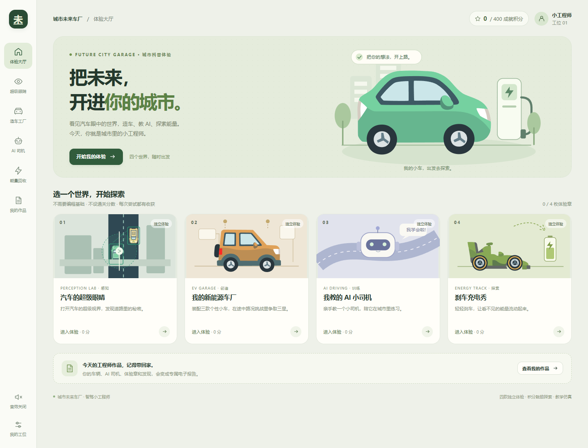
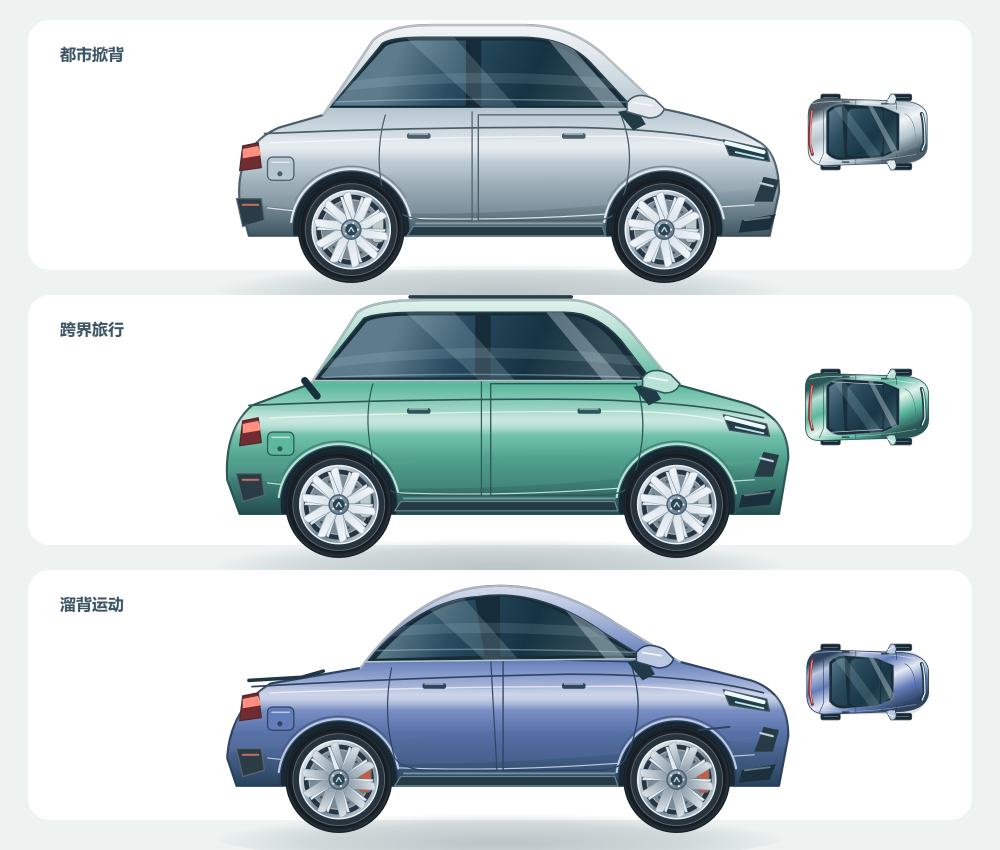
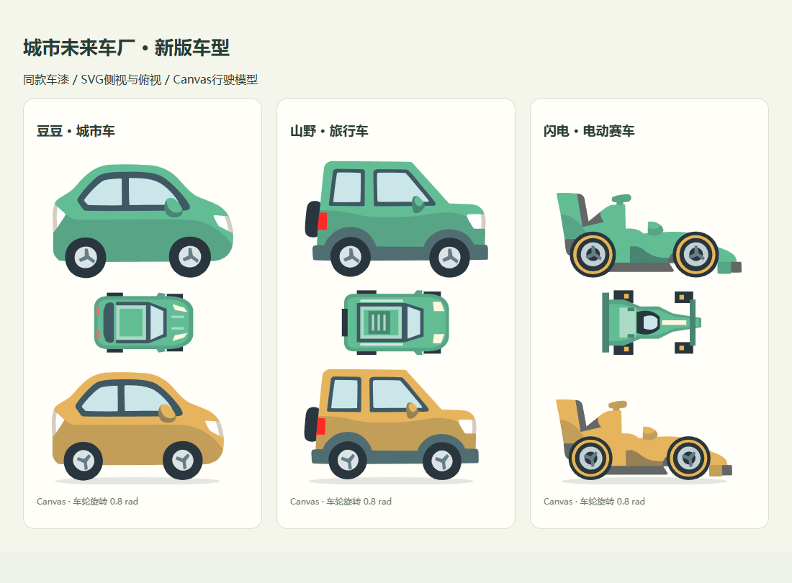
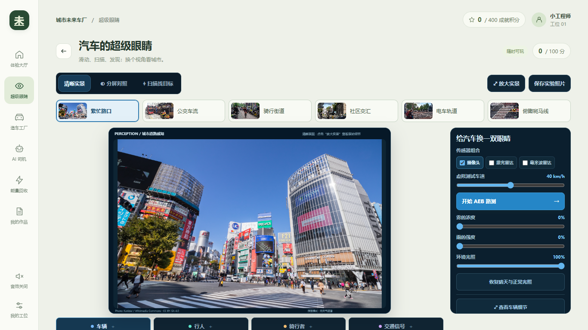
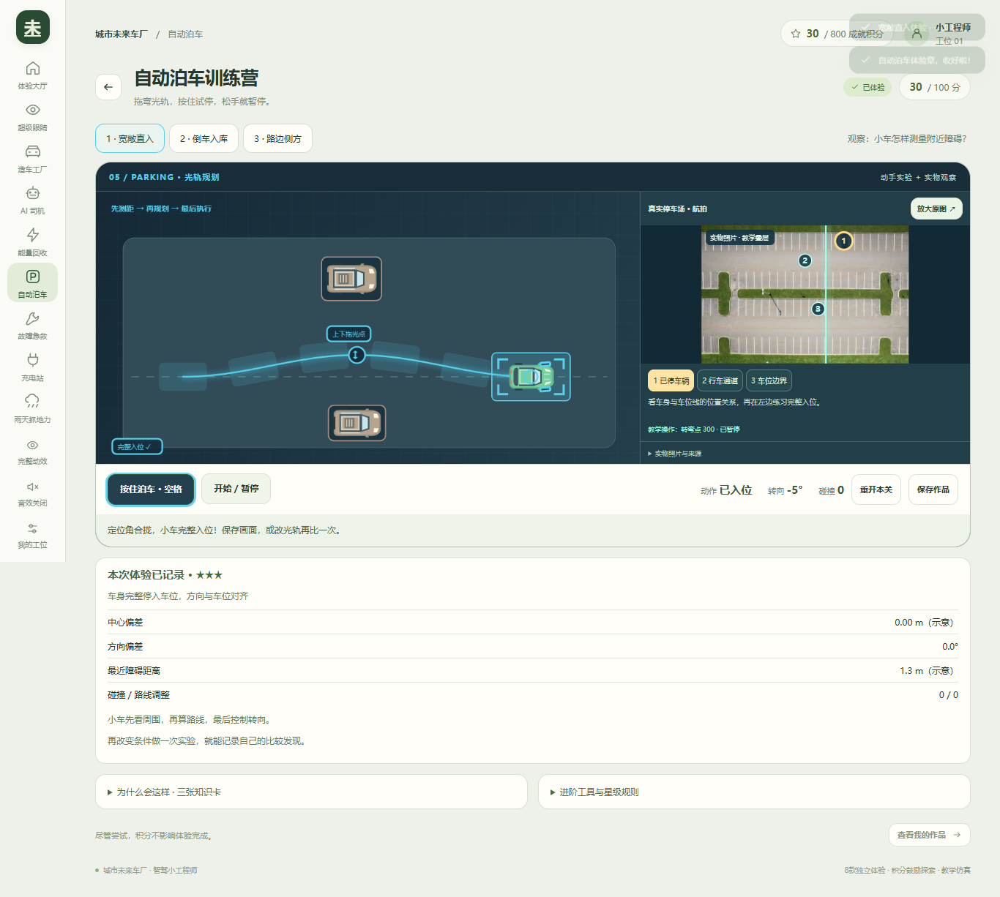
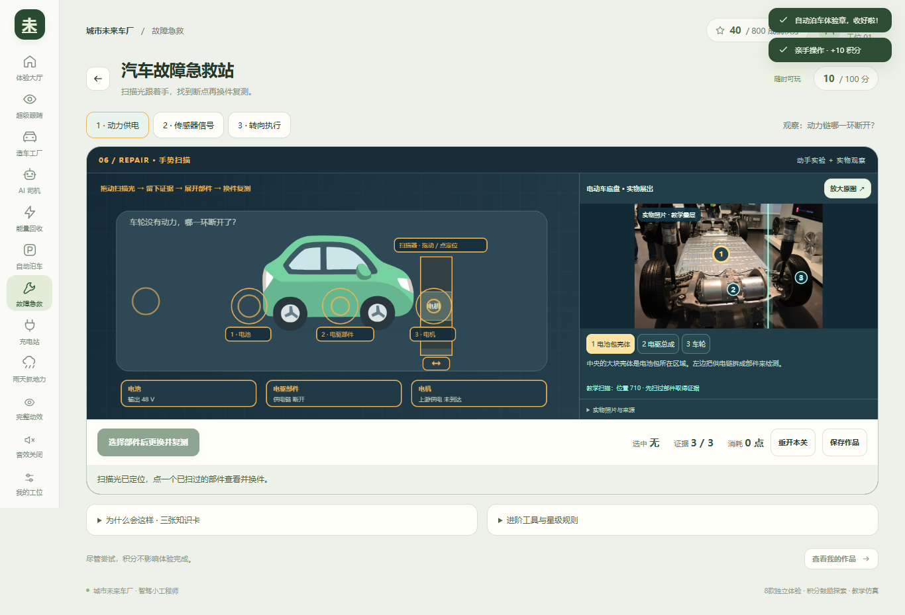
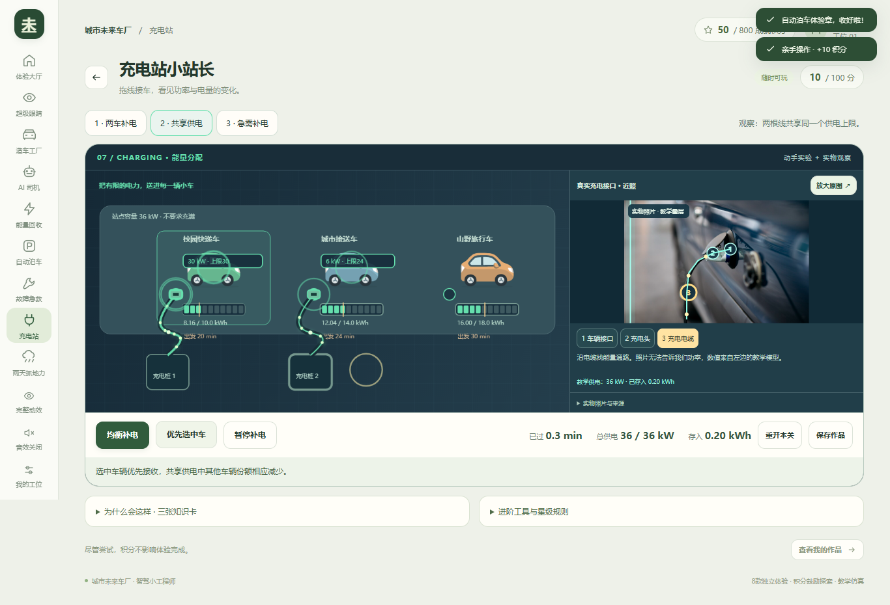
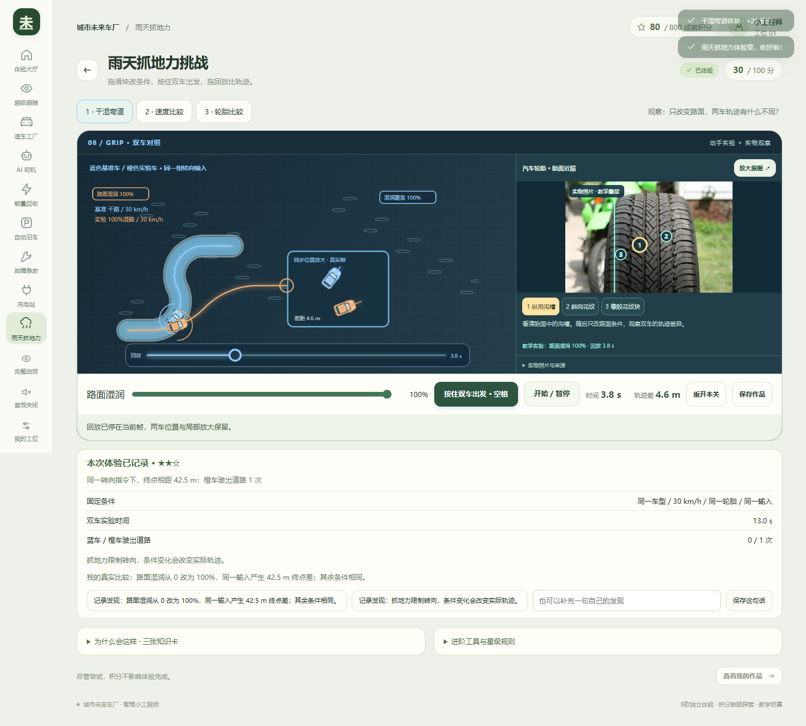

# 城市未来车厂 · 智驾小工程师

八款独立的二维 HTML 科普体验：汽车的超级眼睛、我的新能源车厂、我教的 AI 小司机、刹车充电秀、自动泊车训练营、汽车故障急救站、充电站小站长、雨天抓地力挑战。新增四款以“操作触发特效，特效实时跟手”为重点，并加入六张实物照片作为观察依据。

## 直接运行

双击根目录的 `城市未来车厂-双击打开.html` 即可离线体验；图片、脚本和样式均内嵌，建议使用 Chrome 或 Edge。源码在 GitHub 下载后，可直接在仓库页面打开该 HTML 文件，或克隆到本机运行。

左侧可滚动导航随时切换八款游戏，每款三关均开放。每款 100 分，共 800 分、8 枚体验章；参与与探索只加分；完成主体验即可盖章，低分也可继续和下载报告。

点击“我的工位”修改昵称与工位号。记录自动保存在当前浏览器的本机存储中，旧四款存档自动补齐新增条目，保留原昵称、车辆、积分与截图。每位学生应在自己的电脑浏览器操作；本版本不含跨电脑实时排名或教师汇总端。

“我的作品”可下载独立 HTML 报告、PNG 车辆海报，或通过浏览器打印为 PDF。报告含实际体验记录；未体验项目不会伪装成完成。换浏览器、清理存储或换文件路径可能使用新的存档位置，结课请下载作品。

## 操作

- **感知：**提供繁忙路口、公交车流、骑行街道、社区交汇、电车轨道、俯瞰斑马线六张实景照片。点击缩略图切换场景，标框与扫描记录同步切换；“放大实景”查看照片和目标细节。切换分屏或扫描，试试天气、光照与传感器；展开实验工具查看鸟瞰图、ToF 和辅助制动路测，再保存作品。
- **造车：**拖放部件到汽车，或点击安装按钮；换颜色、改名字、保存车辆。豆豆城市车、山野旅行车和闪电电动赛车采用全新扁平 SVG 造型，分别为圆润小车、方正 SUV 和开放座舱赛车；侧视和俯视造型同步用于其他游戏、海报及报告。默认展示完整车身，“查看动力底盘”展开电池和电机教学示意。
- **任务闯关：**选择校园快递员、山顶补给站或追风远征队。途中有三次路况选择，答错会给出解释，可重新选择；每次选对后点击“继续出发”。跑完全程得一星，至少两题首选正确再得一星，三题全都首选正确获得第三星。18种事件随重玩轮换，答案位置也会变化；结算可以复盘、再挑战或进入下一关，最佳星级自动保存在本机。所有任务都可直接进入。挑战选择决定星级，里程和用电仍由同条件教学模型计算。
- **AI：**为路况选择“走、慢、等”示范，再训练、路测。模型会实际学习这些结构化特征。遇到不合适的动作可补充示范重训。
- **能量：**选择电池状态，点击出发；按住空格或刹车按钮停入绿色区域，也可使用辅助停车。结束后查看能量分配。

- **泊车：**点车位，上下拖发光转弯点，光轨和透明车身包络持续跟手重算；按住“泊车”或空格推进，松手暂停。也可以点光点再点新位置，或展开工具用滑块调节。三关包含前进、倒车、前进后倒车。路线过急或车身会碰撞时会标出冲突，完整入位才结算。
- **维修：**拖扫描光经过三个检测点，实际扫过的位置才留下证据。点已扫描部件展开，再“更换并复测”；信号逐段穿过链路，选错不会修好。可点击定位或使用扫描滑块。三关为动力供电、传感器、转向执行；重开轮换断点，清除本次检测和换件。
- **充电：**拖电缆到车辆发光接口，松手吸附；错误位置回弹。也可先点充电头再点车辆。点车辆查看需求，选均衡或优先分配，电缆光流和电池填充读取实际功率与电量。点已接接口或使用拔线工具可断开；达标车辆自动释放线。接第一根线开始计时，拖线时暂停计时，随时可暂停补电。
- **雨天：**每关只拖一个实验滑块：湿润、速度或轮胎条件。路面预览随手变化；按住双车出发，松手暂停。拖画面下方回放光点，同步定位两车真实记录并显示局部放大。改条件会结束本轮、淡化保留旧轨迹，准备新实验；其余条件固定。

泊车与雨天支持“开始 / 暂停”替代按住操作；充电提供暂停补电，维修提供点击扫描与换件复测。主舞台保持可操作，知识卡和进阶工具默认折叠。左侧“减少动效”关闭粒子和交互装饰，保留模型状态、轨迹和结果；也读取系统减少动效设置。失焦、触摸取消和切换游戏释放按住输入。

四款新增游戏都有实物观察区：停车场航拍、充电接口近照与充电桩、两张展出底盘、轮胎胎面近照。拖照片扫描、点观察点读解释，“放大原图”查看完整照片。场景切换更换照片或观察重点；操作时扫描线、供电光流和说明与模型同步。电脑并排显示，窄屏上下排列；原图弹窗暂停泊车、补电和双车运动，维修复测冻结至关闭弹窗。来源面板可换照片，载入失败可重试。

作品报告保留“我改了什么 / 出现了什么变化 / 我懂了什么”、实际场景和星级；进行中与未体验分别标识。只有实际产生的有效比较才能记录比较发现。新增作品截图合成当时的教学画面与实物照片，包含观察点、摄影作者、许可、原页面和教学边界；报告保留对应实物来源。截图使用最长宽度1200的JPEG，优先保留结构化记录；存储空间不足会提醒立即导出报告。

## 开发

技术栈：TypeScript、Vite、Phaser Canvas、DOM 控件。Node.js 20.19+ 或兼容的较新版本。

```sh
npm install
npm run dev
npm run build
```

Node.js 22.18+ 可运行 `npm test`，验证挑战推进、八游戏存档升级、泊车几何、供电守恒、诊断复测、真实轨迹回放和星级规则（使用 Node 内置 TypeScript 支持）。

需要 Node.js 20.19 或更新的兼容版本。`npm run build` 会在 `dist/index.html` 生成独立离线文件。

新增模型分为 `parking-model.ts`、`repair-model.ts`、`charging-model.ts`、`grip-model.ts`；公共目录为 `game-catalog.ts`，挂载注册为 `game-registry.ts`，共享交互和作品记录为 `games/lab.ts`。

构建通过 `vite-plugin-singlefile` 生成离线单文件页面。各游戏目录只负责自己的教学模型、画面和交互，公共积分、存档与报告在 `src/main.ts` / `src/store.ts`，Phaser 绘制边界在 `src/platform.ts`。

汽车通过 `src/car-art.ts` 统一绘制，包含三款侧视车型和俯视模型；首页、Canvas、SVG 与报告共用实际车型路径。侧视轮廓来自 Google Noto 的静态 SVG，来源、固定版本及内容检查见 `docs/vehicle-art-redesign.md`。可编辑成品位于 `src/assets/vehicles/ready/`；运行 `node scripts/export-vehicle-art.mjs` 可重新导出。画布适配浏览器像素密度，窗口调整保持长宽比，指针操作使用统一逻辑坐标。工坊海报为 2000×2400，报告车辆作品为 1920×1200；报告快照采用最长宽度 1200 的 JPEG，控制浏览器存储占用。

## 教学准确性与素材

道路照片是真实公开照片，目标、距离、鸟瞰位置、采样点、质量指标和波形是人工标注与教学仿真，页面与报告都有标识。照片来自东京、香港、阿姆斯特丹和旧金山。原涩谷照片保留 2500×1604 像素，新增五张照片为 1280 像素宽。场景清单与各图归一化目标框在 `src/games/perception-scenes.ts`，新增照片及来源记录在 `src/assets/scenes/`。

新增实物素材在 `src/assets/lab-photos/`，来源元数据为 `sources.json`；照片与观察点配置在 `src/games/lab-photo-content.ts`，共享加载、扫描、弹窗、导出在 `src/games/lab-media.ts`。照片展示实物形态，教学读数与实验轨迹仍由模型生成。

车辆、AI 决策及能量回收使用简化教学模型；分数代表参与和探索，不是实车性能评价。照片署名与开源依赖见 [ATTRIBUTION.md](./ATTRIBUTION.md)。

## 窗口适配

电脑主工作区最大宽度 1440px，感知主图按可用窗口高度和原比例显示。空间不足时控件区换行；较矮电脑窗口的感知设置面板可滚动，车速与 AEB 主操作靠前。缩略图在窄窗口重排，完整照片始终等比显示，原图放大可滚动查看。

运行 Vite 后，可用 `node scripts/check-responsive.cjs` 做 Edge/Chromium 浏览器回归检查，需要安装 Playwright 或通过 `NODE_PATH` 指向已有包目录。`QA_URL` 可指定离线 HTML 的 `file:///` 地址，`QA_BROWSER_CHANNEL` 可指定浏览器。检查包括 320–1920px 六页面、电脑主图高度、六图逐个扫描/放大/恢复、窗口缩放后分屏拖动及图片失败重试。

新增游戏的真实鼠标/键盘回归：`node scripts/check-new-games.cjs`。沿用上面的 Playwright 包配置，支持 `QA_URL` 指向离线文件。覆盖三关试玩、跟手、吸附与取消、暂停、错误修复、回放、旧存档、报告及320/390/1366/1920px布局。

实物照片专项回归：`node scripts/check-lab-media.cjs`，沿用上面的 Playwright 配置与 `QA_URL`。检查六张真实图片解码、拖动扫描、原图放大、场景切换、与实际功率联动、弹窗暂停、四种窗口尺寸、署名合成截图、报告下载和加载失败重试。

## 验证记录

见 `output/playwright/` 的代表画面与 `验收记录.md`。实际展会仍需在机房设备上检查分辨率、浏览器存储和文件下载设置。

## 预览
















